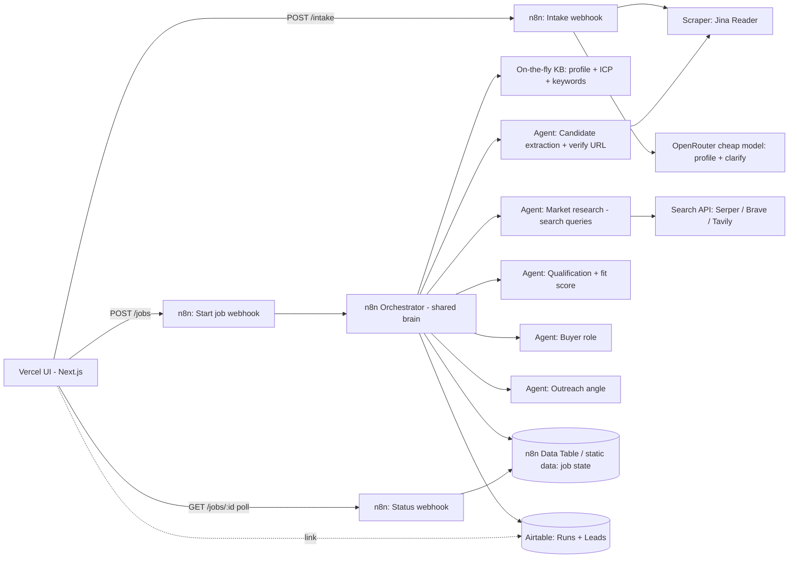

# PRD: iNyra Intelligent Lead Generation Demo

**Version:** 1.0, 14 Oct 2026 | **Owner:** Harshal Sonar (iNyra) | **Builder:** Claude (coding agent) | **Deadline:** working by Sat 17 Oct 2026, morning (IST)

---

## 1. Overview
This is a **sales demo tool**, not a platform. Harshal uses it live in customer meetings to show what iNyra's AI sales engine can do. The customer says what they sell. Harshal types it in (website optional). In 2–5 minutes the system returns **20+ qualified leads from the public web**. Each lead comes with evidence, a fit score, a likely buyer role and an outreach angle.

The pipeline mirrors iNyra's internal sales engine: **Intake → Market research → Qualification → Buyer intelligence → Outreach angle**.

One shared "brain" (an orchestrator workflow with fixed prompts) runs every demo. Only the **knowledge base** changes, and it is generated on the fly from the customer's input. There are no pre-built knowledge bases.

Results show **in the app** (Vercel UI) and are **written to Airtable** (a Runs table and a Leads table, linked by `run_id`).

## 2. Goals and non-goals
**Goals**
- G1: Accept any input: free text only, a URL only, or URL + product. Any company can be picked; nothing is preconfigured.
- G2: Return ≥20 deduplicated leads, each with a real, verifiable URL, within 5 min (target 3 min).
- G3: Show live progress so the meeting stays engaging.
- G4: Show results in the app, export them to CSV, and store them in Airtable.
- G5: Cost ≤ ₹5,000/month at about 10 demos (plus test runs).
- G6: Rough but reliable, with a fallback demo mode that always works.

**Non-goals**
- No multi-tenant platform, user accounts or billing.
- No paid lead databases (Apollo, ZoomInfo, etc.).
- No outreach, sending, email finding or enrichment of personal contact data.
- No invented person names. The tool outputs roles only.
- No pre-built industry knowledge bases.
- No CRM sync beyond Airtable.

## 3. Users and demo scenario
- **Operator:** Harshal (the only user), on a laptop and screen-sharing.
- **Audience:** a business owner or sales head (an SME, e.g. a diagnostics lab, manufacturer, SaaS or agency).

**Scenario**
1. "Tell me what you sell and who you'd love to sell to."
2. Harshal types a sentence, or pastes their site, or picks any company from the web to illustrate.
3. If the input is thin, the system asks 1–2 quick questions.
4. The run starts and the progress feed ticks through the stages.
5. About 3 minutes later a lead table appears. Harshal opens 2–3 leads, shows the evidence links and angles, then shows the same list in Airtable and downloads the CSV.

## 4. User flow (step by step)
1. **Input screen:** one free-text box ("What do they sell / to whom?"), plus optional **Website URL**, optional **Product focus**, optional **Geography** (default: India), and **Lead count** (default 25, max 40). Only one of text or URL is required.
2. **Intake:** the frontend calls `POST /intake`. n8n scrapes the URL if given and normalises everything into a **structured profile** (offer, target market, geography, ICP hypothesis, assumptions).
3. **Clarify (optional):** if `confidence < 0.6`, intake returns **at most 2** clarifying questions. Harshal answers them or clicks **"Proceed with assumptions"**. Stated assumptions are always shown.
4. **Confirm profile:** a profile card is shown (editable inline). Harshal clicks **Find leads**, which calls `POST /jobs` and returns a `run_id`.
5. **Live progress:** the UI polls `GET /jobs/{run_id}` every 2–3 s. It shows the stage stepper, a log feed ("Found 48 candidate companies…") and a running lead count. Partial leads stream into the table.
6. **Results:** a table with company, website, location, fit score, buyer role, a "why it fits" summary, evidence links and outreach angle. Rows expand to show full detail. Buttons: **Export CSV**, **Open in Airtable**, **New run**.
7. **Fallback:** a **Demo mode** toggle (or an automatic switch on failure or timeout) replays a cached sample run with the same live-progress animation.

## 5. Architecture

- **Shared brain:** a single orchestrator workflow and fixed agent prompts. Each agent prompt receives the run's **KB object** (structured profile, ICP, keyword set, exclusions) as context. The KB is swapped per run and never persisted as a reusable asset.
- **Job state:** kept in an n8n Data Table (or Postgres/Redis if Harshal's n8n already has one) keyed by `run_id`. The status webhook reads from it.
- **Airtable:** the system of record for completed and partial runs. The UI reads results from the status webhook, not from Airtable directly, so no Airtable token is exposed to the browser.

## 6. Agents
| # | Agent | Input | Output | Model tier (configurable) |
|---|---|---|---|---|
| A0 | **Intake / Normaliser** | free text, URL page markdown, product, geo | `profile` JSON + `confidence` + ≤2 `questions` + `assumptions` | Cheap-fast (e.g. Gemini Flash / GPT-4o-mini class) |
| A1 | **KB builder** | profile | KB: ICP segments (3–5), buyer industries, trigger signals, 12–20 search queries, exclusions (competitors, the customer itself) | Mid (e.g. Claude Haiku / GPT-4.1-mini class) |
| A2 | **Market research** | search queries | raw SERP results (title, url, snippet), deduped by domain, 60–120 candidates | No LLM (search API) |
| A3 | **Candidate extraction + verification** | SERP items + homepage markdown (Jina) | candidate `{company, website, location, summary}`; drops directories, news sites, listicles, dead URLs | Cheap-fast |
| A4 | **Qualification** | candidate + KB | `fit_score` 0–100, `fit_reasons[]` each with `evidence_url` + quote, `segment`; reject <50 | Strong (e.g. Claude Sonnet class) |
| A5 | **Buyer intelligence** | qualified lead + KB | `buyer_role` (role only, e.g. "Procurement Head"), `secondary_role`, rationale | Mid |
| A6 | **Outreach angle** | lead + profile | `outreach_angle` (1–2 sentences), `hook`, referencing the evidence | Strong (A5 and A6 can be merged into one call to save time) |
| A7 | **Run summary** (optional) | all leads | 3-bullet market summary for the results header | Mid |

Model IDs live in one n8n config node (`MODEL_CHEAP`, `MODEL_MID`, `MODEL_STRONG`) so they can be swapped without touching prompts. Claude (via the existing n8n connection) may be used for A4/A6 if it's cheaper or better there. All other calls go through OpenRouter.

**Anti-hallucination rules (hard requirements)**
- A lead can only originate from a URL returned by the search API or found on a fetched page. The LLM may never introduce a company it wasn't given.
- Each lead's `website` must resolve (HTTP 2xx/3xx via Jina fetch or a HEAD request). Otherwise it's dropped.
- Each `fit_reason` must cite an `evidence_url` from the fetched set.
- Dedupe by registrable domain (eTLD+1), then by normalised company name.
- Exclude the customer's own domain and any competitor listed in the KB.

## 7. Tech stack
- **Frontend:** Next.js (App Router) + Tailwind + shadcn/ui + Framer Motion + TanStack Table + react-three-fiber (orb, with a CSS fallback), deployed to Vercel on a `*.vercel.app` dummy domain. No database. Client-side CSV export. An optional Next.js API route proxies n8n so the webhook secret isn't exposed.
- **Backend:** Harshal's self-hosted **n8n** (webhooks, Code nodes, HTTP Request, Airtable node, Data Table / static data).
- **LLMs:** **OpenRouter** API (per-agent model) and the existing Claude credential in n8n.
- **Scraping:** **Jina Reader** (`r.jina.ai/<url>`, free tier/low cost). Fallback is a plain HTTP fetch plus an HTML-to-text Code node.
- **Search (pick one, keep others as fallback):** **Serper.dev** (2,500 free queries), **Brave Search API** (free tier), **Tavily** (1,000 free credits/month).
- **Storage:** **Airtable** (one base) for results, and n8n Data Table for live job state.

## 8. Functional requirements
| ID | Requirement |
|---|---|
| FR1 | Input accepts free text, URL, URL + product, or any company the operator picks. At least one of text/URL is required. |
| FR2 | Intake scrapes the URL (if any) and returns a structured profile: `offer`, `target_market`, `geography`, `icp_hypothesis`, `assumptions[]`, `confidence`. |
| FR3 | If confidence is low, the app shows ≤2 clarifying questions. Operator can answer or "Proceed with assumptions". Never more than one clarify round. |
| FR4 | Operator can edit the profile before starting. |
| FR5 | `POST /jobs` starts an async run and returns `run_id` in <2 s. |
| FR6 | Status endpoint returns stage, progress %, log lines and leads so far. UI polls every 2–3 s. |
| FR7 | Final output ≥20 leads (target 25). If fewer qualify, return what was found with a note, never padded or invented. |
| FR8 | Each lead has company, website, location, why it fits (with evidence URL), fit score, buyer role (role only) and outreach angle. |
| FR9 | n8n writes one **Runs** record at job start (status updated through the run) and one **Leads** record per lead, linked to the run. |
| FR10 | Results table in the UI is sortable by fit score, with expandable rows, clickable evidence/source links and an **Open in Airtable** link (view filtered to this run). |
| FR11 | CSV export of all leads from the UI. |
| FR12 | Demo mode replays a cached sample run, either manually or automatically if the run fails or exceeds 6 min. |
| FR13 | Cancel button stops polling and marks the run `cancelled` (best effort in n8n). |
| FR15 | UI follows section 9a: no chat-style UI. Three screens (guided intake form, orb processing screen, results table + drawer). Inline clarify cards. Reduced-motion fallback. Dark theme with one accent and iNyra branding placeholders. |
| FR16 | Results table supports sorting, filtering (text, min fit score, location, segment), favicons and a detail drawer. Empty/error states as specified. |
| FR17 | Every demo creates a persistent **Demo Session** in Airtable (customer company, website, raw input, structured profile, clarifying Q&A, assumptions, linked runs/leads, lead count, status, notes), linked to Runs and Leads. Business information only, no personal contact details. |
| FR18 | In-app **Past demos** list (top-bar link): table of sessions (date IST, company, website, status, lead count) with search. Clicking one reopens the session profile and its results on Screen 3 with no re-run, and allows editing notes and "Run again" (a new run linked to the same session). |
| FR14 | No outreach, email lookup or sending anywhere in the system. |

## 9. Non-functional requirements
- **Latency:** intake ≤20 s; full run p50 ≤3 min, hard cap 6 min. First partial leads by about 90 s. Agents A3–A6 run in parallel batches (5–8 at a time).
- **Cost:** ≤₹5,000/month (see the estimate below). Per-run caps are enforced in n8n.
- **Reliability:** each external call retries twice with backoff. A failure on one candidate drops that candidate, not the run. If the search provider errors, the run switches to the fallback provider. Cached demo mode is always available.
- **Fallback demo mode:** ship 2 cached runs as static JSON in the frontend (`/public/samples/*.json`). They replay with simulated progress (about 60–90 s).
- **Privacy:** only public web data. Store company-level data only, with no personal names, emails or phones. Customer input is kept only in the Airtable Runs record. Note in the UI: "Public web data only, no outreach." Webhooks require a shared secret header. OpenRouter/Airtable/Search keys stay in n8n credentials only.
- **Usability:** readable on a projector (large type) and works on a laptop at 1280 px or wider.

**Cost-per-run estimate (approximate, verify current prices)**
| Item | Per run |
|---|---|
| Search: ~20 queries (free tier; ~$0.02 if paid) | ₹0–2 |
| Jina fetches: ~80 pages | ₹0–5 |
| Cheap model (intake, extraction ~80 calls, ~150k tokens) | ₹3–8 |
| Mid model (KB, buyer role, ~30 calls) | ₹5–15 |
| Strong model (qualification + angle ~40 calls, ~120k in / 30k out) | ₹40–90 |
| **Total** | **≈ ₹50–120 per run** |

Budget: 10 demos plus about 30 test runs ≈ 40 runs × ₹120 ≈ **₹4,800 worst case**. Airtable free plan (1,000 records/base) works if old runs are deleted periodically. Otherwise upgrade only if needed (Team plan is extra; flag it as an open question).

**Caps (n8n config node):** `MAX_QUERIES=20`, `MAX_CANDIDATES=80`, `MAX_FETCHES=100`, `MAX_LEADS=40`, `MAX_RUN_SECONDS=360`, `MAX_TOKENS_PER_RUN≈400k`. Set an OpenRouter account credit limit of about $50/month.

## 9a. UI and UX requirements
**Principle:** this must look like a polished product (Linear / Stripe / Vercel dashboard quality), **not** like ChatGPT or Claude.
- No chat bubbles.
- No single prompt box with a scrolling transcript.
- No "AI wrapper" look.

Use iNyra branding placeholders: a logo slot top-left, a wordmark, a `--brand-accent` token and a favicon. All three screens are steps of one app shell (top bar with logo, run name and a demo-mode toggle).

**Suggested stack:**
- Next.js (App Router) + TypeScript.
- Tailwind CSS + **shadcn/ui** (Card, Input, Textarea, Button, Badge, Table, Sheet/Drawer, DropdownMenu, Tooltip, Skeleton, Toast).
- **Framer Motion** for transitions.
- **TanStack Table** for sorting and filtering.
- **react-three-fiber + drei** for the orb, with a CSS-only fallback.
- lucide-react icons.

**Design tokens (dark premium theme, one accent)**
- Background `#0A0A0B`, surface `#111114`, elevated `#18181C`, border `#26262B`.
- Text `#EDEDEF` / muted `#8A8A93`.
- One accent: `--brand-accent` (placeholder `#7C5CFF`, swap for the iNyra colour). The accent is used only for the primary CTA, focus rings, the orb and the high-score badge.
- Fit badges: ≥80 accent, 65–79 neutral-bright, 50–64 muted.
- Font: Inter or Geist (sans) and Geist Mono for numbers.
- Radius 10–12 px, hairline borders, soft shadows, 8-pt spacing grid.

**Screen 1: Guided intake (form/card, not chat)**
- A centred card titled "Who are we finding customers for?" with these fields:
  - Company name.
  - Website (optional, URL-validated).
  - "What do they sell / who do they target" (textarea, required if there's no website).
  - Geography (optional, default "India").
  - Lead count (advanced, collapsed).
- One primary CTA: **"Find leads"**. It calls `/intake` and shows an inline loading state on the button.
- If intake returns questions (max 2), they slide in **as inline cards below the form**. Each card has a short input or suggested-answer chips, plus a secondary "Skip, use assumptions" link.
- Next comes a compact **profile summary card** (offer, target market, geography, ICP hypothesis, assumptions as tags) with inline edit. A single CTA **"Start research"** calls `/jobs`.
- Keyboard: Enter submits. Field-level validation messages.

**Screen 2: Processing (animated orb)**
- A full-bleed centre stage with a **gradient orb** that slowly pulses and shifts colour (accent-based). It reacts subtly to stage changes, e.g. speeding up slightly on each new stage.
  - Implementation: react-three-fiber sphere with a noise-displaced shader (or drei `MeshDistortMaterial`), dynamically imported with `ssr:false`.
  - **CSS fallback:** layered radial gradients with `filter: blur()` and keyframe rotate/scale, used if WebGL is unavailable or the device is low-power.
- Headline: **"We'll get you the details soon"**, with a muted sub-line showing the latest n8n log message (e.g. "Verified 41 company websites").
- **Subtle step progress** below it: Understanding business → Researching market → Qualifying leads → Writing angles. Each step shows done (check), active (pulsing dot) or pending (muted).
  - n8n stages map onto these 4 steps: intake/kb → research/extraction → qualification → buyer/angle/saving.
  - The steps are driven by polling `GET /jobs/{run_id}`, along with a small counter ("18 qualified leads so far") and a quiet Cancel link.
- **Reduced motion:** with `prefers-reduced-motion` (or a toggle), show a static gradient orb with a gentle opacity fade only, and no WebGL.
- Cached demo mode uses the same screen with simulated status timings.

**Past demos screen:** reached from the top-bar "Past demos" link. A clean table (not a chat history): date, customer company + favicon, website, status badge, lead count and a notes indicator, with search. A row opens the session: a profile card plus the Screen 3 results, with "Run again" and an editable notes field. Empty state: "No demos yet."

**Screen 3: Results**
- A header with the run title (company/offer), a 3-bullet summary, stats (leads, avg fit score, run time) and actions: **Export CSV** (secondary), **Open in Airtable** (secondary, external icon), **New search** (ghost).
- A table built with shadcn Table + TanStack Table. Columns:
  - Company (favicon via `https://www.google.com/s2/favicons?domain=<domain>&sz=64` with an initials fallback, name, domain link).
  - Location.
  - Fit score badge.
  - Why it fits (1-line, truncated, with a source-link icon).
  - Buyer role.
  - Outreach angle (truncated).
- Sorting on fit score, company and location. Filtering by search text, minimum fit score slider, location and segment/industry.
- Clicking a row opens a **right-side drawer (Sheet)** with full details: all fit reasons with quotes and evidence links, buyer and secondary role, the full outreach angle with a copy button, and source URLs.
- Rows fade in as partial leads arrive, if the user lands here before the run is done.

**Responsiveness (projected laptop)**
- Optimised for 1280–1920 px and a 1366×768 projector.
- Base font 15–16 px, table rows at least 48 px, high contrast (WCAG AA), no essential info on hover only.
- Below 1024 px, the table collapses less important columns (angle, role move into the drawer).
- Basic mobile view only; no mobile optimisation is needed.

**Empty, loading and error states**
- Intake: inline field errors. "Couldn't read that website, continue with the description" if the scrape fails (not fatal).
- Processing: if there are no status updates for over 30 s, show "Still working, this market takes a little longer". On a timeout or failure, show a card with **Retry** and **Show sample run** (demo mode).
- Results: if there are 0 leads, show an empty-state illustration with "No strong matches found" and buttons to broaden geography or edit the profile. If there are fewer than 20, show a note: "Found N verified leads, we don't pad results."
- Use skeleton rows while loading, and toasts for CSV/Airtable actions.

## 10. Data flow and JSON schemas
**Flow:** UI input → `/intake` → **Demo Session record created (draft)** → profile (+ questions) → UI confirm → `/jobs` (session updated with final profile, clarifying Q&A and assumptions) → orchestrator writes Runs row + job state → agents → leads appended to job state and Airtable Leads → UI polls `/jobs/{id}` → final results + Airtable link → CSV export on the client → session status/lead_count updated. **Past demos:** UI → `GET /sessions` → list; `GET /sessions/{id}` → session + latest run + leads, read from Airtable through n8n.

**Session list / detail response**
```json
{ "sessions": [ { "session_id": "ses_20261016_ab12", "created_at": "2026-10-16T10:00:00+05:30", "customer_company": "Example Aqua", "website": "https://example.com", "status": "done", "lead_count": 26, "latest_run_id": "run_20261016_ab12" } ] }
```
`GET /sessions/{id}` returns `{ "session": {...all fields...}, "runs": [ {run summary} ], "leads": [lead objects of latest run], "airtable_url": "..." }`.

**Intake request**
```json
{ "text": "We make industrial RO water plants for food factories", "url": "https://example.com", "product": "50 KLD RO plant", "geography": "Maharashtra, India" }
```
**Intake response** (intake also creates the Demo Session record with status `draft` and returns its id)
```json
{
  "intake_id": "int_8f2a",
  "session_id": "ses_20261016_ab12",
  "profile": {
    "company_name": "Example Aqua",
    "offer": "Industrial RO water treatment plants (10-100 KLD)",
    "target_market": "Food & beverage, dairy, pharma manufacturers",
    "geography": "Maharashtra, India",
    "icp_hypothesis": "Mid-size F&B and dairy plants (50-500 staff) expanding capacity or facing water compliance",
    "differentiators": ["Turnkey install", "AMC"],
    "exclusions": ["water treatment competitors"]
  },
  "assumptions": ["B2B only", "India focus"],
  "confidence": 0.55,
  "questions": ["Which industries buy most from you today?", "Any minimum plant size?"]
}
```
**Job request (`POST /jobs`)**
```json
{ "session_id": "ses_20261016_ab12", "intake_id": "int_8f2a", "profile": { "...": "edited profile" }, "answers": ["Dairy and beverages", "20 KLD+"], "lead_count": 25, "mode": "live" }
```
**Job status (`GET /jobs/{run_id}`)**
```json
{
  "run_id": "run_20261016_ab12",
  "session_id": "ses_20261016_ab12",
  "status": "running",
  "stage": "qualification",
  "stages": ["intake","kb","research","extraction","qualification","buyer","angle","saving","done"],
  "progress": 62,
  "log": [{ "t": "2026-10-16T10:02:11+05:30", "msg": "Verified 41 candidate websites" }],
  "counts": { "candidates": 74, "verified": 41, "qualified": 18 },
  "leads": [ { "...": "lead objects so far" } ],
  "summary": null,
  "airtable_url": "https://airtable.com/appXXX/tblRuns/viwXXX?filter=run_20261016_ab12",
  "error": null,
  "started_at": "2026-10-16T10:00:02+05:30",
  "finished_at": null
}
```
`status` ∈ `queued | running | done | partial | failed | cancelled`.

**Lead object**
```json
{
  "lead_id": "ld_001",
  "run_id": "run_20261016_ab12",
  "company": "Sunrise Dairy Pvt Ltd",
  "website": "https://sunrisedairy.example.in",
  "domain": "sunrisedairy.example.in",
  "location": "Pune, Maharashtra",
  "industry": "Dairy processing",
  "segment": "Mid-size dairy",
  "fit_score": 84,
  "fit_reasons": [
    { "reason": "Announced new 2 lakh L/day plant in 2026", "evidence_url": "https://news.example.com/sunrise-expansion", "quote": "…commissioning a new facility…" }
  ],
  "buyer_role": "Plant Head / Head of Engineering",
  "secondary_role": "Procurement Manager",
  "outreach_angle": "Congratulate on the new plant; offer a water-audit for the expansion with turnkey RO install before commissioning.",
  "source_urls": ["https://sunrisedairy.example.in", "https://news.example.com/sunrise-expansion"],
  "verified": true,
  "created_at": "2026-10-16T10:03:40+05:30"
}
```

**Airtable base: "iNyra Lead Gen Demo"**

*Demo Sessions table (one record per customer demo; the customer record)*
| Field | Type |
|---|---|
| session_id | Single line text (primary, e.g. `ses_20261016_ab12`) |
| created_at | Date/time (IST) |
| customer_company | Single line text |
| website | URL |
| raw_input | Long text (exactly what Harshal typed) |
| offer / target_market / geography / icp_hypothesis | Long text / single line |
| profile_json | Long text (full structured profile) |
| clarifying_qa | Long text (JSON array of {question, answer or "skipped"}) |
| assumptions | Long text |
| runs | Link to Runs (multiple; a session can be re-run) |
| leads | Link to Leads (multiple, via rollup or direct link) |
| lead_count | Rollup/Number (leads in latest run) |
| status | Single select (draft, running, done, partial, failed) |
| notes | Long text (optional, Harshal's meeting notes) |

**Privacy:** store only the business information the customer gave (company, offer, market, geography). No personal names, phone numbers or emails of customer contacts. The UI shows a hint under Notes: "Business notes only, no personal contact details."

Runs gets a field `session` (Link to Demo Sessions). Leads gets a field `session` (Link to Demo Sessions, or a lookup through `run`).

*Runs table*
| Field | Type |
|---|---|
| run_id | Single line text (primary) |
| session | Link to Demo Sessions |
| created_at | Date/time |
| status | Single select (queued, running, done, partial, failed, cancelled) |
| input_text | Long text |
| input_url | URL |
| product | Single line text |
| geography | Single line text |
| profile_json | Long text |
| offer / target_market / icp_hypothesis | Long text |
| assumptions | Long text |
| lead_count | Number |
| leads | Link to Leads (multiple) |
| summary | Long text |
| duration_sec | Number |
| est_cost_inr | Currency (₹) |
| mode | Single select (live, demo) |
| error | Long text |

*Leads table*
| Field | Type |
|---|---|
| lead_id | Single line text (primary) |
| run | Link to Runs |
| session | Link to Demo Sessions |
| run_id | Single line text (also stored for easy filter views) |
| company | Single line text |
| website | URL |
| domain | Single line text |
| location | Single line text |
| industry / segment | Single line text |
| fit_score | Number (0–100) |
| fit_reasons | Long text (bullets with URLs) |
| evidence_urls | Long text |
| buyer_role / secondary_role | Single line text |
| outreach_angle | Long text |
| verified | Checkbox |
| created_at | Date/time |

The "Open in Airtable" link points to a shared Leads view grouped by `run_id`, filtered to the run if feasible (shared view with a URL filter, or just a view sorted newest-first; see open questions).

## 11. n8n workflow outline
**WF-1 Intake** (`POST /webhook/leadgen/intake`)
1. Webhook (verify `x-inyra-key`).
2. IF url → HTTP Request `https://r.jina.ai/{url}` (timeout 15 s), plus optional `/about` page.
3. Code: trim markdown to about 12k chars.
4. LLM (OpenRouter, MODEL_CHEAP) → profile JSON (JSON mode, schema-validated in Code).
5. Airtable: create the Demo Sessions record (draft, raw input, profile, assumptions).
6. Respond to Webhook (incl. `session_id`).

**WF-2 Start job** (`POST /webhook/leadgen/jobs`)
1. Webhook → Code: create `run_id`, initial state.
2. Data Table insert (job state) → Airtable: update Demo Session (profile, clarifying Q&A, status running) → create Runs record linked to the session.
3. Respond `{run_id}` immediately.
4. Execute Workflow WF-3 (async, "wait for completion" off).

**WF-3 Orchestrator (shared brain)**
1. Load config node (models, caps, provider choice).
2. A1 KB builder (MODEL_MID) → queries, segments and exclusions; update state "kb".
3. Split queries → Search API HTTP (Serper; on error, Brave/Tavily) → merge → Code: dedupe by domain and filter out directories/marketplaces/news/social (blocklist: justdial, indiamart listing pages, linkedin, facebook, wikipedia, etc.). Update state "research".
4. Split in batches (8) → Jina fetch homepage → A3 extraction (MODEL_CHEAP) → drop unverified. Update state "extraction".
5. Batches → A4 qualification (MODEL_STRONG) → filter `fit_score ≥ 50` → state "qualification".
6. Batches → A5+A6 combined call (buyer role + angle) → Code: validate evidence URLs are in the fetched set → append lead to state and Airtable Leads (create, linked to the run and session) → state "angle".
7. Stop conditions: `qualified ≥ lead_count` or time/token cap reached.
8. Optional A7 summary → update Runs (status, duration, cost estimate) and Demo Session (status, lead_count) → state "done" (or "partial").
9. Error Trigger workflow → state "failed" with message → Airtable Runs `error`.

**WF-4 Status** (`GET /webhook/leadgen/jobs/:run_id`) → Data Table lookup → respond JSON.

**WF-6 Sessions** (`GET /webhook/leadgen/sessions`, `GET /webhook/leadgen/sessions/:id`, `PATCH /webhook/leadgen/sessions/:id` for notes) → Airtable search/get (Demo Sessions sorted newest first, latest 50; linked Runs and Leads) → respond JSON.

**WF-5 Cancel** (`POST /webhook/leadgen/jobs/:run_id/cancel`) → set flag. The orchestrator checks the flag between batches.

## 12. API contract (frontend ↔ n8n)
Base: `https://<n8n-host>/webhook/leadgen`. Header `x-inyra-key: <secret>`. JSON only. Recommended: the frontend calls its own Next.js `/api/*` proxy routes, which add the secret server-side.

| Method & path | Body | Response | Notes |
|---|---|---|---|
| `POST /intake` | Intake request | Intake response | ≤20 s; 400 if neither text nor url |
| `POST /jobs` | Job request | `{ "run_id": "...", "status": "queued", "airtable_url": "..." }` | ≤2 s |
| `GET /jobs/{run_id}` | none | Job status (incl. `leads[]`) | Poll every 2–3 s; 404 unknown id |
| `GET /sessions` | none | Session list (newest first, max 50) | Past demos screen |
| `GET /sessions/{session_id}` | none | Session + runs + latest leads + airtable_url | Reopen a demo without re-running |
| `PATCH /sessions/{session_id}` | `{ "notes": "..." }` | `{ "ok": true }` | Notes only |
| `POST /jobs/{run_id}/cancel` | none | `{ "status": "cancelled" }` | best effort |

Errors: `{ "error": { "code": "SCRAPE_FAILED|SEARCH_FAILED|LLM_FAILED|TIMEOUT|BAD_INPUT", "message": "..." } }`. The UI offers **Retry** or **Switch to demo mode**. CORS: allow the Vercel domain (not needed if using the proxy).

## 13. Three-day build plan
Claude runs the two tracks in parallel and Harshal reviews.

**Wed evening / Thu (Day 1): skeleton end-to-end**
- *Frontend:*
  - Next.js + shadcn/ui scaffold on Vercel.
  - Design tokens and app shell with branding placeholders.
  - Screen 1 guided intake form, with inline clarify cards and profile card.
  - Screen 2 with the CSS orb + step progress.
  - Screen 3 basic table.
  - Mocked API using `/public/samples/sample-1.json`.
  - Proxy routes.
  - *Done when:* the full flow clicks through on mock data at the Vercel URL.
- *n8n:*
  - Airtable base and both tables created per schema.
  - WF-1 intake working with a real URL and with text-only input.
  - WF-2/WF-4 with job state and stub leads.
  - Config node + credentials (OpenRouter, Serper, Jina, Airtable).
  - Demo Sessions table created and linked to Runs and Leads; intake creates the session record.
  - *Done when:* curl `/intake` returns a valid profile, and `/jobs` + polling returns stub status and creates a Runs row.

**Fri (Day 2): real pipeline + integration**
- *n8n:*
  - WF-3 agents A1–A6.
  - Dedupe, verification and evidence checks.
  - Leads written to Airtable.
  - Caps, retries, fallback search provider, error workflow.
  - Session status/lead_count updates.
  - WF-6 sessions list/detail/notes endpoints.
  - *Done when:* a live run on test input 1 returns ≥20 verified leads in ≤5 min, and Airtable has Runs + linked Leads.
- *Frontend:*
  - Switch to the live API.
  - Partial leads streaming.
  - WebGL orb (react-three-fiber) with reduced-motion fallback.
  - TanStack sorting/filtering, favicons, fit badges, detail drawer.
  - Evidence links, CSV export, Airtable link.
  - Empty, cancel, retry and error states.
  - Past demos list + reopen session + notes + Run again.
  - Demo-mode replay + auto-fallback.
  - *Done when:* the UI completes a live run end-to-end, and CSV matches the Airtable rows.

**Sat morning (Day 3): harden + rehearse**
- *Both tracks:*
  - Run all 3 test inputs.
  - Tune prompts and the blocklist.
  - Save the 2 best runs as cached samples.
  - Projector styling and polish (spacing, contrast at 1366×768, motion timing).
  - Final branding swap.
  - "Not a chat UI" design review.
  - Check cost per run in the OpenRouter dashboard.
  - Do one full rehearsal.
- *Done when:* 3/3 test inputs succeed (≥20 leads, 0 unverifiable URLs on spot check of 10), demo mode works offline from n8n, and cost per run is ≤₹120.

## 14. Test plan
| # | Input | Expected |
|---|---|---|
| T1 | URL + product: an Indian diagnostics lab's site (e.g. a Pune pathology lab), product "corporate health check packages" | Profile: B2B corporate wellness. Leads: Pune/Maharashtra companies (IT parks, manufacturers) with ≥200 staff. Buyer role: HR Head / Admin. ≥20 leads. |
| T2 | Free text only: "We make industrial RO water plants for dairies and beverage factories in Maharashtra" | No URL scrape. Maybe 1 clarify question. Leads: dairies/beverage plants with plant-head roles and expansion/compliance evidence. |
| T3 | URL only, thin site (a small SaaS or agency homepage), no geography | Low confidence → ≤2 questions. "Proceed with assumptions" works, and assumptions are shown on the results. |

Checks on every run:
- Each lead's website opens.
- Each evidence URL is reachable and relevant (spot check 10).
- No duplicate domains.
- No person names.
- The customer's own domain is excluded.
- Airtable row count = UI count = CSV rows. A Demo Session record exists with Q&A and assumptions, Past demos reopens it without re-running, and no personal contact details are stored.
- Run time and cost are logged.
- Failure injection: bad search key → fallback provider. n8n down → UI offers demo mode.

## 15. Risks and mitigations
| Risk | Mitigation |
|---|---|
| Hallucinated companies or evidence | Leads only from search/fetched URLs, URL verification, evidence-URL whitelist check, strict JSON schema |
| Run exceeds 5 min live | Parallel batches, time cap returns partial results, early stop at lead_count, demo mode |
| Directories/listicles flood results | Domain blocklist + A3 "is this a single company site?" check. Mine listicles for company names, then verify each site separately. |
| Free tiers exhausted / rate limits | Two search providers configured, caps, OpenRouter credit limit |
| Thin or ambiguous customer input | Intake clarify (≤2 questions) and visible assumptions |
| Poor Indian SME web presence | Bias queries with city/state + Indian terms (Pvt Ltd, MIDC, GST); accept fewer leads honestly |
| n8n self-host downtime or webhook timeout | Async job + polling, health check before the meeting, cached demo |
| Airtable free-plan record limit | Clean up old test runs; open question on the plan |
| Sensitive customer info in prompts | Public data only, no personal data stored, keys server-side |

## 16. Open questions
1. Which search provider is primary: Serper, Brave or Tavily? Are any keys already available?
2. Does Harshal's n8n version support Data Tables, or should job state use Postgres/Redis/static data?
3. Airtable plan: is the free plan (record limit) fine, and is a public shared view acceptable for the "Open in Airtable" link?
4. Default geography: India-wide, or the customer's city/state?
5. Should Claude (direct) or OpenRouter be used for the strong-tier agents?
6. Which two cached sample runs should be shown in demo mode (industries most relevant to upcoming meetings)?
7. Vercel project name / dummy domain to use.
